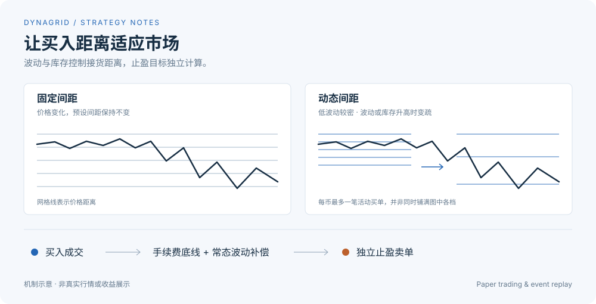
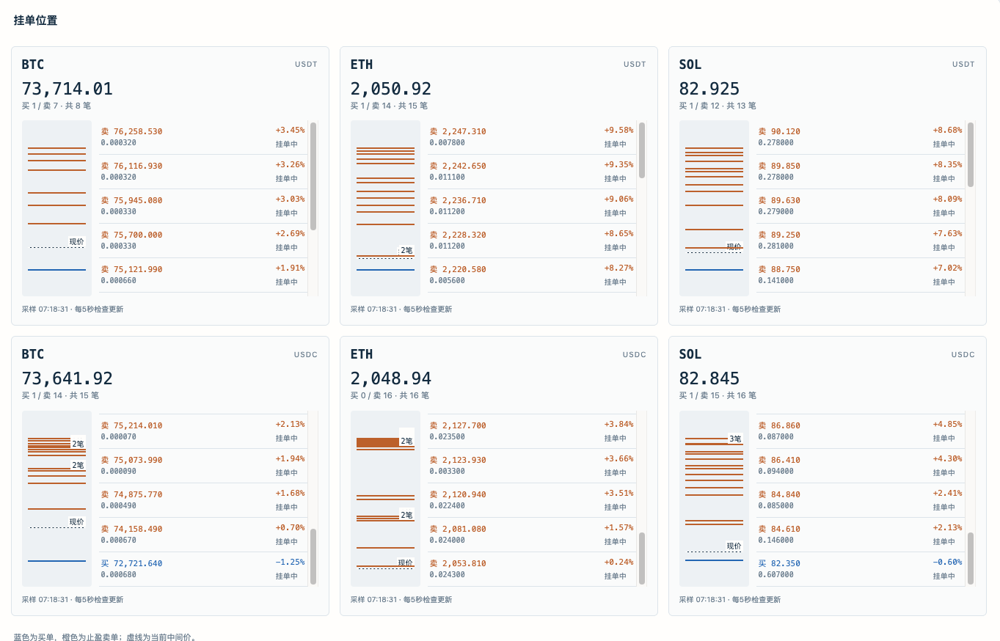

<div align="center">

# DynaGrid

**随波动与库存调整买入距离的配对网格研究工具**

公开行情纸面交易 · 逐事件回测 · 同一套策略引擎

[运行预览](#运行预览) · [快速开始](#快速开始) · [策略逻辑](#策略逻辑) · [回测](#回测已录制行情) · [维护](#维护)

</div>

<p align="center">
  
</p>

## 策略逻辑

**距离适应风险，止盈独立定价。** DynaGrid面向BTC、ETH、SOL现货网格研究，直接使用公开行情，不需要交易所密钥。

| | 固定间距网格 | DynaGrid |
| :-- | :-- | :-- |
| 买入距离 | 使用预设间距 | 随波动与库存变化，扩大快、收紧慢 |
| 接货方式 | 常见方式为预铺多档 | 每币最多一笔买单，受库存和滚动额度约束 |
| 配对退出 | 按预设网格价差卖出 | 每笔成交独立确定扣费后的止盈目标 |

有效行情 → 风险与额度检查 → Maker模拟买入 → 配对挂卖 → 卖出释放库存。
急跌暂停新增买入；已有仓位继续等待止盈。

> **当前为纸面研究工具。** 只做多、不设止损，持续下跌可能积累库存和浮亏；不保证每笔退出，也不保证盈利。

## 运行预览



真实纸面运行截图，非实盘成交或收益证明。蓝线为买单，橙线为止盈卖单，虚线为当前中间价；密集位置的“2笔 / 3笔”表示聚集的订单数量。各卡片独立缩放，距离请以价格和百分比判断。

## 快速开始

需要 Python 3.10+，macOS 或 Linux。

```bash
git clone https://github.com/BaoxiLiu/DynaGrid.git
cd DynaGrid
python -m venv .venv
source .venv/bin/activate
pip install -r requirements.txt
python -m paper_grid backtest --demo
```

演示使用合成行情，只验证流程，不代表历史收益。结果写入 `data/backtest.json`。

使用真实公开行情纸面运行：

```bash
python -m paper_grid paper
```

另开终端启动页面，访问 http://127.0.0.1:8766：

```bash
python -m paper_grid dashboard
```

默认同时观察 BTC、ETH、SOL 的 USDT 与 USDC交易对，两组各1,000计价币。USDT模拟Maker单边费率0.075%，USDC为0；这是实验假设，请按自己的交易条件修改。新实验参数集中在 `paper_grid/config.py`，运行目录通过 `--data-dir` 指定。已有实验从目录中的 `experiment.json` 恢复参数，修改配置需要另建实验或显式迁移账本。

## 回测已录制行情

纸面运行自动录制盘口、逐笔聚合成交和分钟K线，默认保留3天。保留需要的文件后离线回放：

```bash
python -m paper_grid backtest \
  --input data/paper_grid_v2/raw \
  --filters data/paper_grid_v2/market_filters.json \
  --config data/paper_grid_v2/experiment.json
```

支持 JSONL / JSONL.GZ。每行格式为 `{"received": 秒时间戳, "packet": 币安行情消息}`，按接收时间升序排列。过滤规则记录价格步长、数量步长和最小名义额。

回测与纸面共用策略和撮合引擎，从空仓开始，先积累30根已收盘分钟K线。只用报价和穿价成交推断模拟成交，不用K线高低点假装还原Maker队列。结束时保留库存并计入浮盈亏；检查结果中的报价年龄，过期估值不应当作可靠收益。录制文件不能复原所有断线、初始持仓或真实排队行为。

## 维护

只有一套策略实现：`policy.py` 做决策，`engine.py` 管订单与账本，`run.py` 接行情，`replay.py` 回放事件；`storage.py` 保存状态，`dashboard.py` 和 `report.py` 只展示结果。

```bash
python -m unittest discover -s tests -q
```

本项目当前入口仅支持纸面交易，不会提交真实订单。运行数据、个人部署配置和旧实验不属于发布内容。
